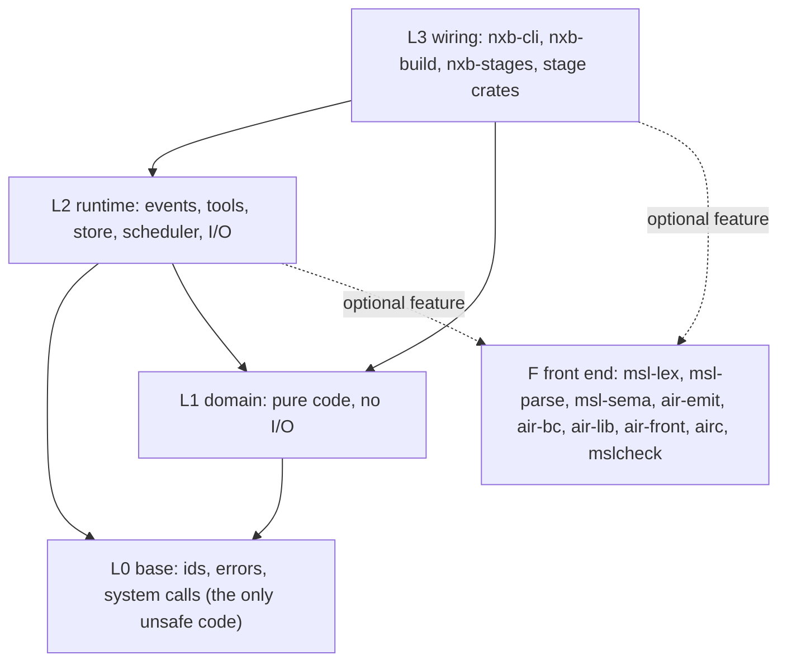
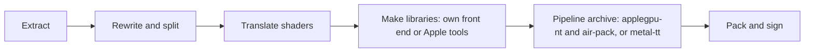

# nxkit

nxkit is a Rust monorepo of modules for running Switch games on Apple devices. Each module is a crate with a declared layer, and
dependencies point down only. Use it only with games that you own. No game data, keys or shaders are in this repository.

- The build tool `nxb` changes Switch game packages into Apple builds. It extracts game data, rewrites and compiles shaders,
  makes pipeline archives, and packs and signs the app.
- The title layer in `titles/` holds engine families and title modules. Refer to [docs/titles.md](docs/titles.md).

The tools replace a set of reference build scripts (written in Python). The reference scripts are the oracle.
A Rust stage is correct when its output files are byte-identical to the output of the reference scripts.
One part is different: the own shader front end. It has two paths. The first path is on only for shaders on an allow list, where its output is byte-identical.
The second path is the raw path. **Since 0.4.0, the raw path is on by default for each Mac shader that the front end accepts.**
Its output is not byte-identical to Apple's output, and a GPU test covered only a part of the shaders (see the status section).
A switch turns it off: `NXB_OWN_RAW=0`. If the front end rejects a shader, Apple's compiler makes the library.

## Status

Version 0.6.6 is the fourteenth public release. It is early software. Read this section before you use it.

- Mac only for the build tools. The tools run on macOS on Apple silicon. Other systems are not supported.
- The tools need Apple tools (`metal`, `metallib`, `air-opt`, `clang`, `metal-tt`, `metal-pack`, `codesign`, `xcrun`) from your own Xcode.
- Changed in 0.6.6: the own front end also makes the iOS shader libraries. No GPU test and no device test covers them. `NXB_OWN_RAW_IOS=0` gives Apple's libraries.
- Changed in 0.6.5: the shader step needs less CPU time and memory, and fewer shaders go to Apple's `metal`. A full shader build for iOS writes the stamp that the framework step needs.
- Changed in 0.6.4: the pipeline archive starts compiler runs by the load of the Mac. The new option `--load-limit` sets the limit.
- Fixed in 0.6.3: the Mac shader step runs without the own-identical allow list, with the raw path on. Before, it stopped with a missing `data/own-front` folder.
- Changed in 0.6.2: the rewrite step follows the engine `88c7e03f`, and the extract stage reports the bytes it writes.
- Changed in 0.6.0: the Rust translator writes MSL directly and is the only translator. The C# translator, `spirv-cross` and the MSL text passes are gone.
  The options `--xlate*`, `--dotnet-root` and `--spirv-cross` and the command `nxb shaders recompile` are removed.
  Refer to [CHANGELOG.md](CHANGELOG.md).
- One Rust translator writes MSL directly. It runs in the process of the shader step. The tools need no .NET runtime and no `spirv-cross`.
  Its output is not byte-identical to the output of the reference build scripts. One game ran with it and looked the same in a check by eye. This is not a GPU test. Unit tests and Metal compile tests on built samples cover it.
- `nxb build --platform ios` runs the iOS flow. Each stage was checked alone. Nobody ran the stages in one run. There is no device test.
- A full build in one run with these defaults was not timed. Each stage was compared alone. A full run on one title had an archive error that 0.5.1 fixes. Nobody ran the full build again.
- **The raw path is on by default.** Its libraries are not byte-identical to Apple's libraries. In a GPU test of 3,625 shaders (about 15 % of the corpus),
  220 gave a different output. Nobody tested the other shaders. If you need Apple's output, set `NXB_OWN_RAW=0`.
- The shader step for iOS is not part of the verified path. Only a sample was compared.
- Unity readers, large text segments (100 MB and more), frame step builds without a local sample and framework and multi-program builds are checked with synthetic files only.
- Vulkan and OpenGL games build for the Mac and for iOS. `nxb-layer` translates their shaders with naga and glslang. The iOS app build of these games has unit tests only. No real game IPA was built.
- Oodle and LZ5 formats decode with the game's own decoder in the Mac host. Only `nxb build` starts the host. `nxb extract` and `nxb split` alone stop with exit code 4 for them.
- The reference scripts remain the fallback. If a stage fails or does not support an input, run the reference script for that stage.
  The tools return exit code 4 for an unsupported input. The caller then runs the reference script. Exit code 3 means damaged data.
  The signer command `nxb sign` returns 3 for unsupported input, and the caller runs `codesign`.

### What is byte-identical to the reference scripts

All results are **measured** on one reference title, unless a line says **estimate**. The extract step was also compared on two
more titles.

| stage | compared on | result |
|---|---|---|
| Extract and split | reference title, base and update | both `RomFS.img`, ExeFS, 12 package files and all tables are byte-identical |
| Extract, `.nup` | one real Switch 2 package (standalone update) and synthetic containers | the RomFS image digest and the ExeFS and icon files are identical to the reference script. Not checked on real data: base game with update and DLC, and the control data |
| Extract, XCI, merged packages (`--app`), dump folders | synthetic fixtures only | byte-identical to the reference extractors. No real sample was available |
| Extract, NSZ | one real file and synthetic fixtures | the decoded NCA is identical to the output of the reference decompressor. The NCZ block mode was not checked on real data |
| App icon, companion app | one title | byte-identical |
| App settings file | 142 profiles, 425 outputs | byte-identical. The header of the multi-program profile is ported. The headers of all profiles are identical to `game.py header` |
| Mac host | one title | reuse key and decoder inputs are identical. The binary is not byte-identical, also not between two runs of the reference script |
| Extract | two more titles (one with an update, `--updates-only`) | `RomFS.img`, ExeFS, control data and icon are byte-identical |
| Shader step, Mac (0.5.1, C# translator) | one full run | 74,421 of 74,422 files are byte-identical. The listing `_b_cas.txt` differs by design. Since 0.6.0 the Rust translator writes the MSL, refer to the translator row |
| Shader step, iOS | 787 sample shaders | 2,889 of 2,889 iOS files are byte-identical |
| App stage and signer | tested bundles | app tree, `Info.plist` and `CodeResources` are byte-identical. The signer matches `codesign` |
| Pipeline archive planning | 18,301 pairs | the plan files are byte-identical. `metal-tt` output is not deterministic, so archives are compared by content |
| IPA writer | a 59-entry sample and a bundle with a 300 MB file | byte-identical. A full game IPA was not built |
| iOS stages (`nxb ios`) | generators and workspace writer on real and synthetic inputs, one title for the IPA | the generators are byte-identical. 75 of 75 IPA entries are equal in name, method, sizes, CRC and attributes. Two entries are equal in part only: the executable (only `__LINKEDIT` differs) and the font file |
| Overlap in `nxb build` | one title, extract, split and shaders reused | the event streams are the same, except the times. 58,211 of 58,211 paths exist in both outputs. All files are byte-identical, except two rebuilt Mach-O files and their lines in `CodeResources` |
| Shader step translator | MSL written by the Rust translator | not compared byte for byte with the reference build scripts. One game looked the same in a check by eye |
| Rewrite (`nxb rewrite`), current engine `f25fa956` | 13 real modules of three titles, 4 synthetic main modules with frame step stubs or cuts, and the 24 synthetic modules of `ue_ring` and `ue_region` | all output files are byte-identical in 12 of 12. One more module stops in the script and in `nxb rewrite` with the same assertion and no output. The 4 synthetic modules are identical. The expected results of the 24 modules do not change |
| Rewrite (`nxb rewrite`), engine `88c7e03f` (0.6.2) | 6 real modules of one title and 11 synthetic main modules | all output files are byte-identical in 6 of 6. The 11 synthetic modules are identical too |
| Rewrite (`nxb rewrite`), script of 0.5.1 | 111 modules: 9 real, 4 synthetic and 98 NRO modules | `.patched.bin`, the six tables and `build_src.sha256` are byte-identical in 111 of 111. The script changed after this comparison |
| Rewrite (`nxb rewrite`), earlier script | 25 real modules, with ZBIC, NRO and frame step stubs | all tables, `.patched.bin` and the fixups are byte-identical. 98 of 98 NRO modules also. The script changed after this comparison |
| Profile files, survey and `nxb profile` (0.5.1) | 1,115 tables of 145 profiles, 11 extractions, 6 surveys | read and write of the tables: 1,115 of 1,115. Guess: 11 of 11. Survey and provisional profile: 6 of 6. Registered profile check: 10 of 10 |
| Split, ZBIC segments (0.5.1) | the four modules of one Switch 2 package, and a synthetic file | each segment hash is correct |
| Rewrite, very large modules and three frame step builds | synthetic modules only | byte-identical to the script. The rules for real code of these builds are not tested |
| NRO collection (`nxb nro`) | one real image | `nro.tsv` and 98 of 98 modules are byte-identical |
| Split, more readers | one real update image with a 17.6 GB archive, and synthetic files | the real image gave byte-identical package files and tables. The other readers (Unity, archive families, Needle, Sumo and more) were compared with the reference functions on synthetic files only |
| iOS profile port | 142 profiles | byte-identical |
| iOS framework, multi-program and IPA reuse | synthetic fixtures, framework IPA with a real `xcodebuild` | framework IPA: 47 of 47 entries equal (executable, framework binary and font file equal in part). The other flows: all files equal on the fixtures |
| Own front end | 23,785 inputs | 23,752 lower and validate. 8,533 final libraries are byte-identical to Apple's |
| Raw path of the own front end | 3,625 candidates, GPU test with 12 vectors | 3,375 gave the same output as Apple's library, 220 gave a different output, 29 were not deterministic and 1 was not built. The libraries are **not** byte-identical to Apple's. The other shaders have no GPU test |

### Timings

The reference machine is an Apple M2 Max (8 performance cores, 4 efficiency cores). Other jobs used the CPU in all runs.
The numbers are therefore a little worse than on an idle machine. Source: `docs/benchmarks.md`.

| step | reference scripts | nxkit | speed-up | label |
|---|---|---|---|---|
| Extract and split | 210 s | 10.5 to 15.5 s | 13 to 20 times | measured |
| Shaders, cold, Apple front end | 799 s | 650 s | 1.2 times | measured |
| Shaders, cold, own front end (identical output only) | 799 s | 586 s | 1.4 times | measured |
| Shaders, cold, own front end (validated output) | 799 s | 416 s | 1.9 times | measured |
| Pipeline archive, `applegpu-nt -j 1` and `air-pack` | 257 s | 207 s | 1.2 times | measured |
| Pipeline archive, `metal-tt` (when the two tools above are missing) | 257 s | 273 s | 0.94 times (slower) | measured |
| Mac app stage, fresh | 129 s | 23 s | 5.6 times | measured |
| `nxb build`, shaders given | about 623 s | 317 s | 2.0 times | measured |
| Full build in sequence | 1,422 s | about 960 s | 1.5 times | estimate |
| Raw path, compile CPU for each library, 44 shaders | 109 ms | 97.5 ms | 1.1 times | measured, small sample, loaded machine. The left time is nxkit without the raw path |
| `nxb build` with overlap, shaders given | 136.2 s | 133.0 s | 1.02 times | measured, one run, no cold gain shown. The left time is the earlier `nxb` binary |
| `nxb build` with overlap, cold | | | | not timed. A gain is an estimate |
| Rewrite of a 29 MB main module | 63 s | 3.4 s | 19 times | measured, machine not quiet |
| Rewrite of a larger main module | 121 s | 8.9 s | 14 times | measured, machine not quiet |
| Shader step subset (160 keys), raw path against Apple's compiler | 14.4 s | 6.5 s | 2.2 times | measured, not a benchmark, load average 8 to 12 |
| Full cold build with the raw path on all shaders | | | | not measured. The earlier estimate of 4 to 6 minutes less is an estimate |

The first estimate in the table is the sum of the measured stages, and it does not use the 0.4.0 changes. It was not run as one process. The estimate uses the archive time of 273 s. The own front end is not byte-identical in the validated mode.

### Known limits

- The Rust translator is new. It is the only translator, and its output is not compared byte for byte with the reference scripts. A key that it does not translate gets the reason `translation failed` or the reason that the translator names.
- The Ampere path is checked on one package. Its jobs come from a new Rust job writer. Nobody compared them with the job writer of the reference scripts.
- The raw path is not byte-identical to Apple. A GPU test covered 3,625 shaders, and 220 differed (about 6 %). The check in the process looks at the container only.
  The raw path also makes the iOS libraries. No GPU test and no device test covers them. Apple's `air-validate` accepts them.
  After a change of the front end, an old raw cache entry can stay in the store.
- The own-identical allow list is not in this repository. Without it, only the raw path runs. A new Metal toolchain version has no verdicts, and then only the raw path runs.
- The pipeline archive uses Apple tools. "Equal" means that the loader finds each base library.
- The app stage puts about 58,000 loose library files in the app. The reference script packs one image file. The host reads the two forms. `DMSH_IOS_PULL=0` is not ported.
- The rewrite step is checked against the script of the engine `f25fa956` on 13 real modules of three titles and 28 synthetic modules.
  The finders for Unreal and Snowdrop have no real positive sample. The layouts of three more titles and some frame step stubs are checked with synthetic files only.
  Three more titles were not checked again with the current script.
- Each change of the engine changes the hashes that the rules pin. Make the rules again (`nxb rewrite-rules`) and compare the oracle cases. If the engine differs from the pin,
  `nxb rewrite` stops with exit code 4, and `nxb build` stops at the rewrite step with exit code 1. The message gives the two hashes.
- Not supported in `nxb extract` and `nxb split` alone (exit code 4 with a named message): Oodle formats, LZ5. `nxb build` decodes them in the Mac host.
  The file table of a CRA archive is read from the NROs in `DM_NRO_DIR`. Without a table the split stops with a named message. The CRA reader was checked with a synthetic NRO and archive only.
  The base game of a sparse program is read only with its update NSP (`--updates-only`). Without the update it stops with exit code 4, as in the reference.
  The sparse reader follows the Atmosphere algorithm and was checked with a synthetic fixture only. The meta hash layer of a sparse section is not verified.
  The checksums of LZ4 frames are not checked. A base game with its update in one run gives an error in the reference split and in this split.
- XCI, merged packages, dump folders, NSZ block mode and DLC were checked with synthetic files only. One real NSZ file was checked. `nxb build` does not split the shader content of DLC.
- `nxb build` was run with a registered profile on one title (Mac app). A game without a profile gets a provisional profile. The heap check, the region check and the shader captures boot the game in the Mac host.
  These boots were tested with synthetic data only. With `--no-heap-check`, the memory layout is a guess. Nobody checked it with a run. The shader step and the stages after it were **not** run for the Switch 2 package.
- `nxb build` reads the files of `RomFS.img` at build time (Unreal paks, Frostbite headers and the other source checks of the reference script). They were checked with synthetic files only.
  `--platform mac` (the development build) ends with the command that runs the game on the Mac. It does not run the pipeline prebuild, which starts the host. For a game that imports `nn::jit`, it sets `DM_JIT_CAPTURE` to `<version>/jit_capture/play`.
  `--program N` and the other programs of a multi-program profile are built for `--platform mac` and `mac-app`. They were checked with synthetic files only. An iOS build of a profile with `programs` packs the first program only. `--allow-shader-regressions` has no effect. `--mac-sign` was not run with a real identity.
- iOS: no device test. The IPA writer is serial.
- The overlap of stages is partial. The shader step does not start while the extract runs. Nobody timed a cold full run on a quiet machine. Each gain from overlap, the host and the raw path is an estimate.
- `nxb cache` exists. The shader step does not write cache entries at this time, thus the cache is empty. `--shader-manifest` and `--partial` have unit tests only.
- Some error lines start with an old program name (`nxb-extract:` and others). `nxb self-check` finds the external tools only. The signer command `nxb sign` gives exit code 3 for an unsupported input. The other commands give exit code 4.
- The release ZIP file has an ad-hoc signature and no notarization.
- There is one program, `nxb`. The separate program names of earlier releases (`nxb-extract`, `nxb-split`, `nxb-ios`, `nxb-macapp`, `nxb-ipa`, `nxb-pack`, `nxb-pso`, `nxb-archive`, `shaderbuild`, `airc`) are gone. Use `nxb <command>`.
- Not done: Windows and Linux. On a system that is not Unix, the process runner and the locks refuse to run. The tests run on macOS only.
- Two processes can write the same store key at the same time. The last writer wins. The files stay valid.
- Parsers read untrusted files. Read [SECURITY.md](SECURITY.md) and [docs/security.md](docs/security.md) for the limits.

## Install from a release

1. Download the ZIP file and the `SHA256SUMS` file from the release page.
2. Check the file: `shasum -a 256 -c SHA256SUMS`.
3. Unpack the ZIP file. The binary `nxb` has an ad-hoc signature.
4. If you downloaded the ZIP file with a browser, macOS can block the binary. Remove the quarantine flag of the whole folder: `xattr -dr com.apple.quarantine <folder>`.

## How to try this release

This is a short path for a first test. The reference scripts stay the fallback.

1. Unpack the ZIP file into one folder. The folder holds one program, `nxb`, and the folder `rewrite-rules`. Keep them together.
   If you used a browser, run `xattr -dr com.apple.quarantine <folder>` first.
   Add the folder to `PATH`, or give the full path of `nxb`. Every stage is a command of `nxb`: `nxb extract`, `nxb split`, `nxb shaders`, `nxb ios`, `nxb airc` and more. Run `nxb help` for the list.
2. If the reference engine calls the tools for the extract and the split, set `DM_EXPERIMENTAL_BUILDER=1` and set `NXB_BIN` to the folder from step 1.
   The engine then runs `nxb extract` and `nxb split`. It runs the reference step again when the command returns a code that is not 0.
   An engine that still runs `nxb-extract` or `nxb-split` does not find them in this release. Make sure that your engine runs the commands.
3. Test the rewrite step alone: `NXB_ENGINE=<engine folder> nxb rewrite <module> <out dir> <name>`. The engine folder must be the version that the rules come from. If not, the exit code is 4.
4. Test the build: `nxb build --dry-run <arguments>` prints the stage graph. Then run `nxb build <arguments>`.
   The default platform is `ios`, as in the reference script. For a Mac app, add `--platform mac-app`.
5. The raw path is on. To get Apple's libraries, set `NXB_OWN_RAW=0`. To turn off all own tiers, set `NXB_OWN_FRONT=0`.
6. Read the exit code and the `[RED]` lines. Exit code 4 means unsupported input. Run the reference script for that step and tell us the case.

## Build from source

You need Rust 1.99 or newer and Xcode command line tools. The workspace has no external crates.

```sh
cargo build --release -p nxb-cli   # output: ./target/release/nxb
tools/check.sh             # format, lints, tests, documentation, layer and size checks
```

Set `CARGO_BUILD_JOBS` to limit parallel compiler processes. Set `CARGO_TARGET_DIR` to move the output.

## The program

There is one program, `nxb`. Every stage is a command. Run `nxb help` for the list and `nxb <command> --help` for the usage of one command.
The stage commands keep the command line and the exit codes of the programs of earlier releases. The table in [CHANGELOG.md](CHANGELOG.md) gives each old program name and its new command.
The tests for this are small. Refer to the section 0.5.0 of the changelog.

| command | purpose |
|---|---|
| `nxb build` | the whole build. `nxb build --platform mac-app` (or `mac`, `ios`) runs all ported stages. `--dry-run` prints the stage graph and the cache keys. It takes NSP, NSZ, XCI, XCZ, merged packages (`--app`), `.nup` (`--nup`), dump folders (`--dump`) and DLC (`--aoc`). A game without a profile gets a provisional profile (`--provisional`, `--survey-only`, `--no-heap-check`, `--profile-out`). Exit codes: 0, 1, 2, 3, 4, 6 and 130. Refer to [docs/pipeline-stages.md](docs/pipeline-stages.md) |
| `nxb profile` | `guess`, `show`, `check` and `manifest`: the survey values of a game and the checks of a profile |
| `nxb extract` | NSP, XCI, NSZ, XCZ, Switch 2 package (`.nup`, no keys needed) or dump folder (`--dump`) to RomFS images, ExeFS, control data and icon |
| `nxb split` | shader split of extracted images into package records and tables. Exit code 4 means unsupported format |
| `nxb rewrite`, `nxb rewrite-rules`, `nxb nro` | the code rewrite step, the rule files and the NRO collection |
| `nxb shaders` | the shader step: `build`, `guards`, `own-verdicts` |
| `nxb pso`, `nxb archive` | plan and merge of the pipeline archive, and one archive from a script. They need `metal-tt` and `metal-pack` |
| `nxb app` | the Mac app stage |
| `nxb ipa` | IPA writer |
| `nxb ios` | the iOS stages: `ipa [<out.ipa> \| --prepare-xcode]` and `shell --prepare-xcode \| --build`. Exit code 4 means unsupported |
| `nxb sign` | ad-hoc signer for bundles and Mach-O files |
| `nxb airc` | the own MSL to AIR front end: `emit`, `bc`, `build`, `check`, `rank` |
| `nxb cache`, `nxb prune`, `nxb regressions`, `nxb self-check` | the shader cache of a title, the store and checks |

### Example

```sh
nxb extract --keys <prod.keys> --base <base.nsp> --out <dir> --update <update.nsp> <dir-v2>
nxb build --dry-run <arguments>     # print the stage graph first
```

### Options of `nxb build`

Run `nxb help build` for the full usage. Refer to [docs/pipeline-stages.md](docs/pipeline-stages.md) for the state of the test of each option.

| option | meaning |
|---|---|
| `--platform mac\|mac-app\|ios` | the target. `mac` is the development build: it prints the command that runs the game. The default is `ios` |
| `--program N` | one program of a multi-program application is a game of its own. Its title ID is the application's title ID + N |
| `--engine DIR`, `-k KEYS`, `--work-dir D`, `-o OUT`, `--progress json` | the engine folder, the keys file, the work folder, the output and the NDJSON events |
| `--nup FILE`, `--dump FOLDER`, `--app ID`, `--title-id ID`, `--aoc PACKAGE` | the inputs: a Switch 2 package, a dump folder, a game in a merged package, DLC |
| `--env-file`, `--motion`, `--no-motion`, `--seen-shaders`, `--romfs bundle\|separate`, `--keep-extracted`, `--show-fps` | the options of the reference script |
| `--allow-damaged`, `--allow-other-metal`, `--allow-shader-regressions` | let the build go on after a damaged file or a newer Metal compiler. The last option has no effect |
| `--mac-sign ID` | signs the app again with an identity. Not run with a real identity |
| `--gpu ARCH\|none` | the architecture of the pipeline archive. `none` skips the archive. Default for `mac-app` with `shader_pairs.tsv` in the profile: the architecture of this Mac. Default for `ios` with `pso_mtl4` on in the profile: the `pso_gpu` list of the profile, else `g18p`. Else there is no archive |
| `--provisional`, `--survey-only`, `--no-heap-check`, `--profile-out D` | a game without a profile: provisional profile, survey only, skip the checks that start the game, the folder of the profile |
| `--own-front on\|off` | the own front end |
| `--threads N` | parallel jobs of the shader step and the extract. The default is the Mac's P-core equivalents, `round(P + 0.4 × E)`: 10 on an M2 Max |
| `--load-limit PERCENT` | the pipeline archive starts more compiler runs while CPU and memory use stay below this share of the Mac. The default is 90 |
| `--team-id`, `--framework`, `--shell-framework`, `--prepare-xcode`, `--xcode-workspace` | the iOS options. No device test |

### Exit codes of `nxb build`

| code | meaning |
|---|---|
| 0 | done |
| 1 | error. Also a rewrite stage that stops because the engine files differ from the pinned files |
| 2 | incorrect arguments |
| 3 | damaged data |
| 4 | not supported. Run the reference step |
| 6 | a key is missing |
| 130 | interrupted by SIGINT or SIGTERM |

With `--progress json`, standard output has NDJSON events only.

### Environment variables

The tools read no fixed private path. Inputs come from arguments or from these variables.

| variable | used by | meaning |
|---|---|---|
| `NXB_TEST_TMP` | tests | scratch folder for store and I/O tests |
| `DEVELOPER_DIR`, `SDKROOT` | `nxb-tool` | location of the Apple tools. They are passed to child tools |
| `NXB_AIRC` | `tools/front` | the `airc` binary of the front end workspace (`cargo build --release -p airc`). Default is `target/release/airc` |
| `NXB_PROTO`, `NXB_REF`, `NXB_CORPUS`, `NXB_SPECS`, `NXB_CAS` | `tools/front`, `tools/gpudiff` | inputs that you provide. See `tools/README.md` |
| `NXB_PARITY_*` | parity tests | game files for the comparison tests. Without them the tests skip |
| `NXB_ORACLE_EXACT` | signer tests | set to `1` to compare bytes with the `codesign` of the host. Without it, the tests check that `codesign --verify` accepts our output. Set it on the Mac where the signer was proven |
| `NXB_OWN_FRONT` | `nxb shaders` | set to `0` to turn off the own front end |
| `NXB_OWN_RAW` | `nxb shaders`, `nxb build` | not set: the raw path is on for each shader that the front end accepts. `0`: off. `list`: only the shaders of `raw-verified.txt` in the `data/own-front` folder of the build machine. The release does not have this file, and then the raw path is off. A file name: only the shaders of that list |
| `NXB_OWN_RAW_IOS` | `nxb build` | `0`: Apple's compiler makes all iOS libraries. Not set: the iOS libraries follow `NXB_OWN_RAW` |
| `NXB_REWRITE_RULES` | `nxb rewrite` | a folder with rule files. The default is `rewrite-rules` next to the binary, then `data/rewrite-rules` of the checkout |
| `NXB_REWRITE_PATCHES` | `nxb rewrite` | a snapshot file instead of the rule folder |
| `NXB_TMP` | `nxb extract` | a folder for decoded streams that do not fit in memory |
| `NXB_ENGINE` | `nxb build`, `nxb ios`, `nxb rewrite`, `nxb profile` | the folder with the engine files that the build, the iOS stages, the rewrite step and the survey read. `--engine` of `nxb build` comes first |
| `NXB_ORACLE_*`, `NXB_ZBIC_EXEFS` | tests | inputs for the tests that compare with the reference scripts and the ZBIC reader. Without them the tests skip |

## Architecture

The workspace has four layers and one separate layer for the own front end. Dependencies point down only.
The command `cargo run -p xtask -- layers` enforces this. The engine families and title modules are layer T in `titles/`. Refer to [docs/titles.md](docs/titles.md).



The build of one game has these steps. On the Mac, the own front end makes the shader libraries in the process by default. Apple's tools `metal`, `air-opt` and `metallib` make the libraries that the own front end rejects.



The index of the documents is in [docs/README.md](docs/README.md).

## Parity tests

Tests that need game files are marked `#[ignore]` or skip themselves. When a variable is not set, the test prints `skipped` and passes.

```sh
NXB_PARITY_BASE=<base.nsp> NXB_PARITY_UPDATE=<update.nsp> NXB_PARITY_KEYS=<prod.keys> \
NXB_PARITY_GAME=<profile game.tsv> NXB_PARITY_REF=<work folder of a reference build> NXB_TEST_TMP=<scratch> \
  cargo test -p nxb-extract --release --test parity_real_data -- --ignored
```

Keys and game files stay on your machine.

## Contributing and security

Read [CONTRIBUTING.md](CONTRIBUTING.md) before you open a pull request. To report a security problem, read [SECURITY.md](SECURITY.md).

## License

GPL-3.0-only. See [LICENSE](LICENSE). Anyone may use nxkit. Whoever passes on a changed version must publish its source under the same licence.
Releases up to 0.9.2 were published under MIT and stay under MIT. Notes about formats, external tools and the MIT parts are in [THIRD_PARTY.md](THIRD_PARTY.md).
