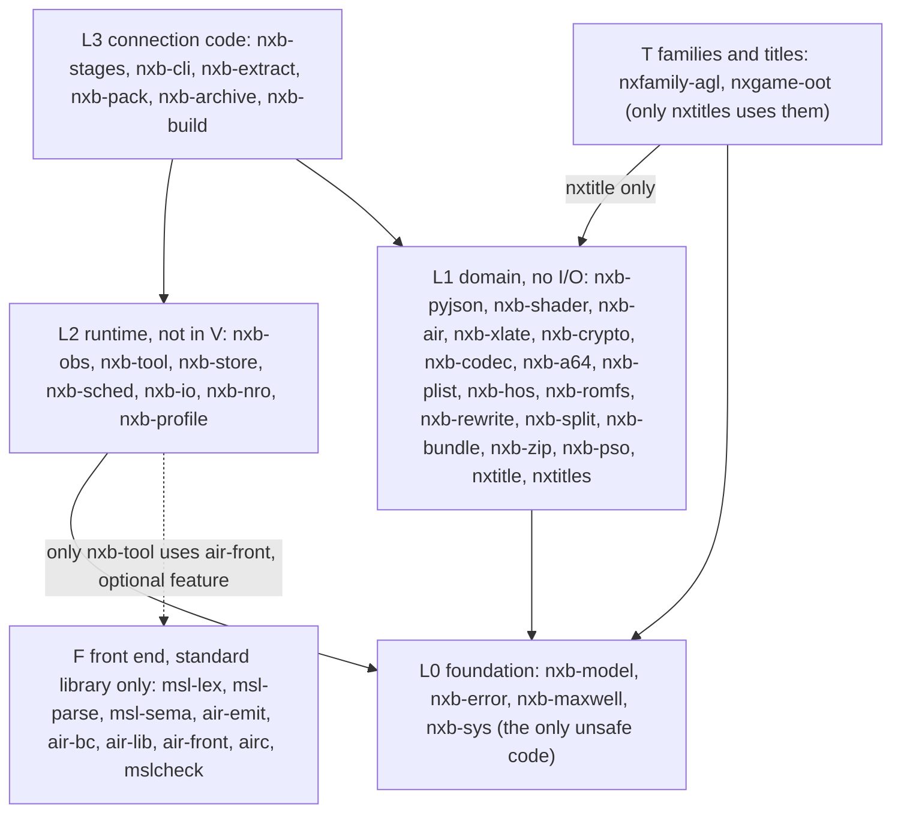
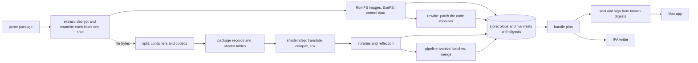

# Architecture overview

This document gives the structure of the workspace: the layers, the crates and the data flow between the stages.
For the decisions behind this structure, refer to [decisions.md](decisions.md).

## Workspace

- The repository is one Cargo workspace. The crates of the build are in `crates/`. The families and title modules are in `titles/` (refer to [titles.md](titles.md)). The developer tools are in `xtask/`.
- Each crate has the name `nxb-<concern>`. The front-end crates of layer F keep their names (`msl-*`, `air-*`, `airc`, `mslcheck`).
- `nxb-cli` makes the one program, `nxb`. Each stage is a command of `nxb`: `build`, `extract`, `split`, `rewrite`, `romfs`, `profile`, `rewrite-rules`, `nro`, `shaders`, `app`, `ipa`, `sign`, `pso`, `archive`, `ios` and `airc`. The other commands are `cache`, `prune`, `regressions`, `self-check` and `version`. The stage crates are libraries, and `nxb-cli` calls them. The stages have no other program and no dispatch by the program name. The front-end crates `airc` and `mslcheck` also build their own programs.
- The workspace uses the standard library only. At this time, it has no external crates.

## Layers

A crate can use only crates of a lower layer, plus the sideways edges in the table below. The command
`cargo run -p xtask -- layers` makes sure that the crate graph obeys these rules. It reads the layer from
`[package.metadata.nxb]` in each `Cargo.toml`.

The rules:

1. L0 holds the identifiers, the digests, the error classes and the system calls.
2. L1 does no I/O. Its crates are pure functions over bytes and text that return `Result`. L1 can call `nxb-sys` only for pure calculations.
3. L2 runs tasks, keeps blobs, starts child processes and writes events. `nxb-tool` also wraps the Metal tools and the shader front ends. `nxb-nro` collects the NRO files of a game.
4. L2 does not make output bytes of the shader step.
5. Only `nxb-sys` contains `unsafe` code. All other crates forbid `unsafe_code` in the lint settings of their `Cargo.toml`.
6. L3 connects the stages. One stage module has a maximum of 400 lines.
7. The development crates (`nxb-testkit`, `xtask`) are dev-dependencies only.
8. Layer F uses no `nxb-*` crate. Only `nxb-tool` can use `air-front`, and only `nxb-cli` can use `airc`. Both are behind the cargo feature `air-front`.
9. Layer T holds the families and title modules. A `T` crate uses only `nxtitle` and L0. Only `nxtitles` uses a `T` crate.

### Sideways edges

| from | to | cause |
|---|---|---|
| nxb-error | nxb-model | the identifiers in the error types |
| nxb-model | nxb-sys | ARMv8 SHA-256 instructions. The digests do not change (W17). |
| nxb-air | nxb-shader | declared for the in-process front end (W18, skeleton) |
| nxb-shader | nxb-pyjson | the JSON files of the shader step |
| nxb-hos | nxb-romfs, nxb-crypto, nxb-codec | the NCA data section is a RomFS, AES, NCZ blocks |
| nxb-romfs | nxb-crypto | the `romfs.id` digests |
| nxb-rewrite | nxb-a64, nxb-codec | the AArch64 decoder, LZ4 segments of NSO files |
| nxb-split | nxb-codec, nxb-romfs | decompression, the walk through the image |
| nxb-bundle | nxb-plist | `Info.plist` |
| nxb-zip | nxb-codec | deflate |
| nxb-xlate | nxb-pyjson | the job file and the JSON of the reflection |
| nxb-nro | nxb-split | the reader of the large archive |
| nxb-pso | nxb-pyjson | tables and stamps |
| nxb-cli, nxb-build | nxb-extract, nxb-pack, nxb-archive | the L3 stage crates (W19) |
| nxb-cli | nxb-build | the `nxb build` orchestrator (W19) |
| nxb-cli | nxb-stages | the shader step of `nxb shaders build` |
| nxb-build | nxb-stages | the shader step in the build graph (W19) |
| nxtitles | nxtitle | the registry builds the catalog of the title API |

## Crates

"V" means that the crate has `in_v = true` in `[package.metadata.nxb]`. The layer check makes sure that such a crate uses only crates with V. The chain version V itself is a hash of the engine files that `dm/gfx/tools/dmsh_chain.py` lists in `FILES`, plus the options string `debug=True reduced=True`. No Rust source goes into V.
"impl" means that the crate has a full implementation. "skel" means that the crate compiles, but has stubs with documentation only.

| crate | layer | V | state | function |
|---|---|---|---|---|
| nxb-model | L0 | yes | impl | identifiers (`ShaderKey`, `TitleId`, `Target`, `StageId`), `Digest`, own SHA-256, `ContentKey`, `HashingWriter` |
| nxb-error | L0 | yes | impl | error classes, reason strings, `BuildError`, `EnvError` with errno classes |
| nxb-sys | L0 | no | impl | process groups, memory size, core counts, locks, clonefile, exclusive publication, zlib, optional libzstd, AES, SHA instructions |
| nxb-maxwell | L0 | yes | impl | decoders for Maxwell and Ampere (sm_86) machine code of the game GPU |
| nxb-pyjson | L1 | yes | impl | a JSON writer that gives the same bytes as Python `json.dumps`. Measured: byte-identical on 16,269 JSON files of the reference title. |
| nxb-shader | L1 | yes | impl | the job writer, the chain version, guards, the header, the target conventions, the side library cut |
| nxb-air | L1 | yes | skel | the in-process front end (planned, W18) |
| nxb-xlate | L1 | yes | impl | the Rust translator: decode, control flow, SSA, passes, structured IR and MSL with a typed `Reflection` (`nxb_xlate::msl::translate`). Refer to [translator.md](translator.md) |
| nxb-a64 | L1 | no | impl | an AArch64 decoder and the encoders for the rewrite step. It follows Capstone 5 for the fields that the rewriter uses |
| nxb-rewrite | L1 | no | impl | the code rewrite: NSO and NRO load, rules as data, the five tables |
| nxb-codec | L1 | no | impl | the ZBIC decoder (`nxb_codec::zbic`). The other codec modules are empty. |
| nxb-romfs | L1 | no | impl | hash-checked, in-place resource edits over caller-owned bytes |
| nxb-crypto, nxb-plist, nxb-hos, nxb-bundle, nxb-zip, nxb-pso | L1 | no | skel | pure domain logic. Some of it is in the stage crates at this time. |
| nxb-split | L1 | no | impl | containers, shader keys, package records and tables. It supports many container families (refer to [pipeline-stages.md](pipeline-stages.md)). Formats that are not ported stop with a named `Unsupported` error and exit code 4. |
| nxb-obs | L2 | no | impl | NDJSON events, sinks and the code table (`code` and `severity`) |
| nxb-nro | L2 | no | impl | the NRO collection (`nxb nro`) |
| nxb-profile | L2 | no | impl | the profile of a game as typed data, with a TOML reader and writer. `nxb-build` uses it for `nxb profile` and the provisional profile |
| nxb-tool | L2 | no | impl | `Tool` trait, `Invocation`, environment allow list, watchdog, circuit breaker, `FrontEnd` trait |
| nxb-store | L2 | no | impl | content-addressed blobs, keyed entries with manifests, quarantine, cache export and import |
| nxb-sched | L2 | no | impl | work-stealing executor with token and memory budgets, single-flight |
| nxb-io | L2 | no | impl | parallel hashing of files and folders (`hash_files`, `hash_tree`) |
| nxb-stages | L3 | no | impl | the shader step. It calls `nxb-xlate` in the process |
| nxb-cli | L3 | no | impl | the program `nxb` with all commands |
| nxb-extract | L3 | no | impl | extract and fused split for NSP, XCI, NSZ, NUP and dump folders. The commands are `nxb extract` and `nxb split` |
| nxb-pack | L3 | no | impl | the Mac app stage, the ad-hoc signer, the IPA writer |
| nxb-archive | L3 | no | impl | the pipeline archive: plan, batches, merge |
| nxb-build | L3 | no | impl | the orchestrator `nxb build`, the rewrite step, opt-in resource overlays, the host stages and the iOS stages |
| nxtitle | L1 | no | impl | the title API: `Family`, `Title`, the hooks, `Fact` and `Evidence`, the `Catalog` that composes them. Refer to [titles.md](titles.md) |
| nxtitles | L1 | no | impl | the registry: one cargo feature per family and title module |
| nxfamily-agl | T | no | impl | the family of Nintendo EPD games on sead, agl and gsys |
| nxgame-oot | T | no | impl | The Legend of Zelda: Ocarina of Time for Nintendo Switch 2 (`0400486024DEC000`) |
| nxb-testkit, nxb-xlatedev, xtask | dev | no | impl | seeded generators, the corpus tool of the Rust translator (`xlate-corpus`), the layer and size checks |
| msl-lex, msl-parse, msl-sema, air-emit, air-bc, air-lib, air-front, airc, mslcheck | F | no | impl | the own front end. Refer to [frontend.md](frontend.md). |

## Data flow of the stages

The arrows show data only. There are no barriers between the stages. The split starts on the first file that the
extract decrypts. The first archive batch starts when its libraries are in the store. Only the seal waits for all data.

## Store format and API stability

Each store key has a stage version and the content hash of the stage inputs. Only the translator key `nxb.xlate.v2` contains the chain version V (W21, [early-cutoff.md](early-cutoff.md)).

The store format 1 has these folders: `blobs/<2 hex>/<64 hex>`, `entries/<2 hex>/<64 hex>.manifest`, `quarantine/`, `tmp/`, `dirty/`.
A manifest is text with sorted names and a checksum line.

The API of the shared crates (`nxb-model`, `nxb-error`, `nxb-tool`, `nxb-store`, `nxb-sched`, `nxb-obs`) does not change in one primary version of the workspace. A change that breaks the API is a separate
commit with a note in `CHANGELOG.md`.
