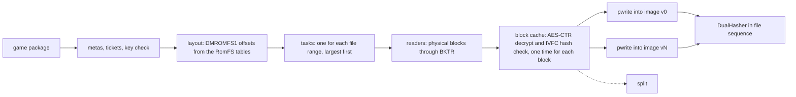

# Pipeline stages

This document gives the stages around the shader step: extract, split, rewrite, pack, sign and the pipeline archive.
Each stage is a pure data change, and the reference build scripts give a correct output for it.
Thus the acceptance rule is byte identity with the reference build scripts.

## Scope

| stage | reference build scripts |
|---|---|
| extract (NSP, XCI, NSZ, NUP, dump to `extract/<ver>/`) | a C# extractor, one process for each version, in series |
| rewrite (patches of the code modules) | Python with Capstone, process pool |
| split (shaders out of the game files) | Python, pool of 8 processes |
| Mac app, pack and sign | Python, `cp -c`, `codesign` |
| IPA and iOS shell | shell, Python, `xcodebuild` |
| pipeline archive | 19 batches of 1,000 bases in series, `metal-tt`, `metal-pack` |

For the timings, refer to [benchmarks.md](benchmarks.md). Not in scope: a replacement of `metal-tt`, `metal-pack`, `xcodebuild` or `clang`, a change of the host file formats
(`DMROMFS1`, package records, `romfs.id`, `prebuilt.tsv`), and network access.

## One hash for each byte

The stage that makes a byte calculates its digest while the byte is in memory. A subsequent stage does not read payload bytes again to hash them.

- A manifest holds for each file: relative path, mode, length, SHA-1, SHA-256 and a stat fingerprint (`dev`, `ino`, size, `mtime_ns`, `ctime_ns`).
- A consumer compares the stat fingerprint with one `fstatat` call. If the fingerprint does not agree, the consumer hashes the file and counts it. This is not an error.
- Only the `files` list of `CodeResources` uses SHA-1. `DualHasher` calculates SHA-1 and SHA-256 in one pass.

The store makes the work folder (`<id>_build/extract/<ver>/`, `shader/cache/b-<V>/`) with one directory clone on APFS, or with a copy on other file systems.

## Extract

- **Layout first.** The image format puts the file bytes in sorted entry sequence without padding, then the index.
  Thus the stage knows the offset of each file before it reads data. Parallel `pwrite` calls give the same bytes as a sequential writer.
- **One pass for all versions.** The base version and the update use mostly the same base blocks. The block cache decrypts
  and examines each block one time and gives it to all tasks that use it.
- **Damaged blocks.** A block that does not agree with the IVFC hash marks its files as damaged. Without `--allow-damaged`,
  the stage lists all damaged files and stops with exit code 3. With `--allow-damaged`, it writes the bytes and sets the damaged flag.
- **Special packages.** Each special case (sparse NCAs, XCI secure partitions, merged NSPs, NUP, dump folders) gets a named test with a synthetic fixture.
- **Exit codes:** 1 error, 2 incorrect command, 3 damaged data, 4 not supported, 6 missing key.
  Exit code 4 means that the caller must run the reference step. This is the same for `nxb split`, `nxb rewrite`, `nxb nro`, `nxb ios` and `nxb build`.

At this time, the stage supports NSP packages (NCA, IVFC, BKTR, RomFS image, ExeFS, NACP, zstd, LZ4).
It also reads game cards (XCI), compressed packages (NSZ and XCZ), Switch 2 packages (`.nup`) and dump folders.
A `.nup` package needs no keys. Use `nxb extract --nup <game.nup>`.
Use `--dump <folder>` for a dump folder. The output layout is the same as the layout of the reference script for dump folders.
The stage writes `extract/v<version>/` (ExeFS, RomFS image, control data and icon) and `aoc/<index>.img` for each DLC.
It checks each file against its size and its SHA-256, and it stops on a damaged or incomplete package.
Without `--version`, it takes the newest update. When the package has no base game, it uses the update as the whole game.
`--discard-images` makes the digests and does not write the images. `--no-images` writes only the code modules and the control data.

- **XCI.** The stage reads the secure partition of the game card.
- **NSZ and XCZ.** The stage decodes the NCZ block streams and the NCZ solid streams with the own zstd decoder.
  The decoder streams the data and has an output limit. The stage needs no external program.
- **Merged packages.** A package can hold more than one game. `--app <id>` gives the application id in hexadecimal.
  The stage then uses only the contents of that application.

Not ported at this time: the `--html` output of some titles. The base game of a sparse program stops with exit code 4 unless its update NSP is read in the same run.

### Tests on real data

- NSP: three titles.
- NUP: one real package (a standalone update). The RomFS image digest, the ExeFS and the icon are identical.
- NSZ: one real file. The digest of the decoded NCA is identical to the digest of the output of the reference decompressor.
  The NCZ block mode was not checked on real data.
- XCI, merged packages (`--app`) and dump folders: only synthetic fixtures. The output is byte-identical to the output of the reference extractors on these fixtures.
  No real sample was available.

## Split

- The split reads file bytes from the block cache of the extract. It examines a file when the extract decrypts the last block of the file.
  When the extract output is in the store, the split reads the image with `ParallelReader`. It reads a file only one time.
- Each container family is a module. `sniff` uses magic bytes, not file names. Nested containers recurse with a depth limit.
- The key of a shader is `sha256(control[:0x880] ‖ code)[:16]`.
- The output sequence is the contract. Rows record the first occurrence. The split sorts the results in the walk sequence
  of the reference build scripts: versions, sorted paths, `main`, NROs, captures. It does not use the completion sequence.

Since version 0.4.0, the split reads many more container families. A format that is not ported stops the split with a named
`Unsupported` error and exit code 4. The split never gives a silent difference.

| family | state |
|---|---|
| SARC, BNSH, BAHS, NSO, GLSLC outputs, NARC, sized frames, gzip files | ported. Compared with the reference functions on real or synthetic files |
| zstd dictionaries (standard format) | ported. Files of one real title are byte-identical to the output of `zstd -D` |
| archive families that the reference split reads by ranges (a large archive, zip, KPKA, CPK, dvdbnd, ARH, LINKDATA, Unreal packages and others) | ported. The split reads the archive by ranges from the image. A 17.6 GB archive is never in memory |
| NSO segments with ZBIC compression (flag bit 7) | ported. The decoder is `nxb-codec::zbic`. The split and the rewrite use it. The four modules of the Switch 2 package were read and each segment hash was checked. A synthetic NSO also passes |
| Unity bundles and serialized files (LZMA, LZ4, stored blocks, format 17 to 22, type trees) | ported. Compared on synthetic files only, because no real Unity title was available |
| Needle, Sumo, Phyre, MGFX, XNB, SLCT, Monolith, Snowdrop, SDF, MT Framework and some more | ported. Compared on synthetic files |
| formats that need Oodle or LZ5 (Oodle packs, Trinity packs, Frostbite superbundles, PKZ, GFPAK, Unreal 3 archives, Unreal pak blocks) | ported. The game's own decoder runs in the Mac host in its tool mode (`DM_OODLE_SERVE`, `nxb-extract::oodle_host`). `nxb build` starts it when the profile's shader sources name Oodle packs or legacy Unreal paks, and only on a Mac with Apple silicon. `nxb extract` and `nxb split` alone have no host, so these formats still stop them with exit code 4. Compared on synthetic files with a fake decoder only |
| the CRA family | ported. `nxb-split::cra` unscrambles each file and checks its checksum. The file table is read from the NROs of `DM_NRO_DIR`, and a missing table stops the plan. Each NRO is also scanned like main. Compared with the reference script on a synthetic NRO and archive made by `tools/gen_cra_fixture.py` |
| zip members (stored, Deflate, bzip2, lzma) | ported. The decoders are `nxb-split::bzip2` and `nxb-split::unity::lzma`. Compared with vectors from Python's `zipfile`, `bzip2` and `xz` |
| BND3 entry names in Shift JIS | ported. `nxb-split::sjis` decodes ASCII, half-width katakana and JIS X 0208 like Python's `shift-jis` codec with `replace`. A test compares all 65536 byte pairs with the codec. The table is made by `tools/gen_sjis_table.py` |
| Unreal shader code archives in paks, with an AES-256 index | ported in `nxb build` (`nxb-split::jobs::uejob`, `boot/uedec.rs`). The key comes from main. LZ4 shaders decode in nxb, Oodle shaders decode in one boot of the Mac host (`DM_OODLE_JOB`). The split reads `<version>/ue_shaders`. Checked with the AES test vectors of FIPS 197 and SP 800-38A and with synthetic archives. No real game was run |
| Unreal Engine 5.6 IoStore shader libraries | ported in `nxb build` (`nxb-split::jobs::uetoc` and `uelib`, `boot/uedec.rs`). The decode reads the `.utoc` tables and the `.ucas` partitions by ranges. Stored, zlib and LZ4 blocks decode in nxb. Oodle blocks and the Oodle shader groups decode with the game's own decoder in the Mac host (`DM_OODLE_SERVE`). An encrypted container opens with the AES-256 key of the paks. The archive names come from the `Manifest_*.txt` files. Checked with synthetic containers and a fake decoder only. No real IoStore game was available |

Real data: the update image of one title with a 17.6 GB archive gave all 12 package files and all tables byte-identical to the reference split (measured: 298 s, and about 25 minutes for the reference).
The reference scripts read approximately 35 container formats, and the port covers most of them. Only the real image and the NSP titles have real-data results. For all other families, the evidence is synthetic.

## Rewrite

`nxb-rewrite` decodes each AArch64 instruction of each code module with the own decoder `nxb-a64`. It changes `x18`,
`tpidr*`, `svc`, `cntpct_el0`, misaligned `sp`, lock acquires, spin loops, cuts and observation gates. It writes
`.patched.bin` and six TSV tables (`changed.tsv` is the sixth). The command is `nxb rewrite <module> <out dir> <name>`. It has the command line of `patch_nso.py`.
The extract stage of `nxb build` runs it for the modules of the profile.

- **Input.** NSO and NRO modules. The loader reads LZ4 segments and ZBIC segments (a zstd variant, with an own decoder), and it checks the SHA-256 of each segment.
- **Decoder.** `nxb-a64` follows Capstone 5 for the mnemonic, the operand text, the registers and the write-back. A test compared 2.7 million distinct words of 9 modules with 0 differences.
  The decoder rejects some words that Capstone decodes (SVE, SME, MTE and most extensions after Armv8). The modules tested have none of these.
- **Layouts.** The rewriter has the layouts of the script: near, far, and two patch areas. If the first size of the front area is too small, it runs again with the size that it needs, as the script does.
- **Rules are data.** The registered patches (cuts, observation gates, capabilities, frame step stubs and the build rows of the game tables) are in `data/rewrite-rules`.
  There is one file for each scope, and one file with the hashes of the engine files. Each rule has a binding: `build` (a fixed offset in one build ID, with the original bytes),
  `sdk`, `game`, `engine` or `host`. A `build` rule without its original bytes is an error. The rules come from a snapshot (`snapshot.tsv`) and a test makes the snapshot again from the files.
  The licence notice of the engine that the rules come from is in `data/rewrite-rules/NOTICE` and in `THIRD_PARTY.md`.
- **Where the rules are found.** In this sequence: `NXB_REWRITE_RULES` (a folder), `NXB_REWRITE_PATCHES` (a snapshot), the folder `rewrite-rules` next to the binary (the release ZIP file),
  `data/rewrite-rules` above the binary or in the checkout, and last the older file `rewrite_patches.tsv` next to the script.
- **When the port refuses.** The port gives exit code 4, and the caller runs the script, in three conditions. The first is an engine file that hashes differently from the file that the rules come from. The message gives the two hashes.
  The second is a set `DM_GAMES_DIR`. The third is a frame step stub that the trace cannot express.
  In `nxb build`, an engine that differs stops the rewrite stage with exit code 1 and the same message. A jump table that no rule knows stops with exit code 1, the address and the function name.
- **NRO modules.** `nxb nro <RomFS image> <out dir> [<nrr name>]` collects the NRO modules that the `.nrr` files list. It has the command line of `nro_collect.py`.
  It reads the archive index of the large archive by ranges. It gives exit code 4 for an image of another format, for hashes that are left after the index (the scan of the script is not ported),
  and for a damaged `.nrr` file.

Results (measured, the reference script as oracle, all six tables and `.patched.bin` byte-identical unless a line says synthetic):

| input | result |
|---|---|
| 0.5.1: the script of the current engine. 9 real modules (the reference title, a second title and the Switch 2 package), 4 synthetic main modules and 98 NRO modules | 111 of 111 identical (`.patched.bin`, the six tables and `build_src.sha256`) |
| 25 real modules, including a Switch 2 title with ZBIC segments, modules with NRO tables and modules with frame step stubs | 25 of 25 identical |
| 98 NRO modules of one title | 98 of 98 identical, and `nro.tsv` identical |
| synthetic modules with text of 100, 125.3 and 185.6 MB, and the two re-run cases | identical. Only the layout code and the registered rows are tested |
| synthetic main modules of three frame step builds and of one build with registered cuts | identical. The words are the asserted original bytes only |
| the rules from `data/rewrite-rules` | 120 of 130 earlier cases ran again and were identical. 14 cases cannot run again, because their input files are deleted |
| 2026-11-06: the script of the engine `88c7e03f`. 6 real modules (`main`, `rtld` and `sdk` of the base package and of the update of one title) | 6 of 6 identical (all files of the output folder, including `build_src.sha256`) |
| 2026-11-06: 11 synthetic main modules for the finder `ue_ring` (`tools/gen_synth_ring.py`) | 11 of 11 identical (length and SHA-256 of each output file, and the lines of the log) |
| 2026-11-08: the script of the engine `f25fa956` with the patches of NX2Apple. 13 real modules of three titles (`main`, `rtld`, `sdk` and `subsdk*`) | 12 of 12 identical (all files of the output folder). One `main` stops in the script and in `nxb rewrite` with the same assertion ("no split reaches") and writes no files |
| 2026-11-08: the 4 synthetic main modules of `tools/gen_synth_nso.py` with frame step stubs or cuts, made from the new snapshot. One of them is the build of Hyrule Warriors: Age of Calamity with the two new frame step sites | 4 of 4 identical |
| 2026-11-08: the modules of `tools/gen_synth_ring.py` and `tools/gen_synth_region.py` made again with the script of `f25fa956` | `expected.tsv` and the 24 logs do not change |

Time (measured, release build, machine not quiet): a 29 MB main module took 3.4 s against 63 s for the script. A larger module took 8.9 s against 121 s.
The synthetic large modules took 1 to 3.5 s against 183 to 672 s. The NRO collection took 3.5 s against 4.5 s, because the archive table dominates both times.

The older script gave the 25 real modules and the other rows below the first row.
The script then changed in 551 lines. Version 0.5.1 ports these changes: the acquire order of locks (`ldaxr`), the Trinity barrier, `changed.tsv`, the observation gates at each instruction that can move,
`BACK_MIN`, the recognizers of jump tables, the proof of tail calls and the finders `ue_cvar`, `ue_malloc`, `ue_region`, `fps_target` and `snowdrop_pools`.
The rules in `data/rewrite-rules` come from the engine `f25fa956` with the patches of NX2Apple (152 files). A pin holds the hash of each engine file that the rules use.
After an engine change, make the rules again with `nxb rewrite-rules`, and compare the oracle cases again.

The engine `88c7e03f` changed two pinned files. `patch_nso.py` runs the new finder `ue_ring.py` on a main module (Unreal's dynamic buffers keep 4 copies instead of 3). `nso_match.py` reads the word `0xe7ffdefe` as `brk #0`, and it accepts a replacement branch whose target stays inside the matched function.
Both are ported (`crates/nxb-rewrite/src/ring.rs` and `matchrule.rs`). The pins have 13 files, and the rule files have the new patch and game rows of this engine.

The engine `f25fa956` changed one pinned file. `patch_nso.py` has three changes: a jump table's bound is the compare that a branch acts on (upstream `e49afb1e`), the walk for a table base passes a page-zero constant (`9671a581`), and branches inside an exclusive window stay in its copy (`10fd9705`).
All three were ported before (`jumps.rs`, `windows.rs` and `analyse.rs`). The pin of `patch_nso.py` changes. The rules have the two new frame step sites of Hyrule Warriors: Age of Calamity and the build rows of three new profiles.

Not tested: rules on real code of the builds that have no local sample, and modules with words that the decoder does not cover.
Not rechecked with the current script: three more titles (their images are not extracted).
The finders `ue_cvar`, `ue_malloc`, `ue_region`, `ue_ring`, `fps_target` and `snowdrop_pools` have no real positive sample. `ue_region` is tested on synthetic main modules (`crates/nxb-rewrite/tests/region.rs`, made by `tools/gen_synth_region.py` with the script). `ue_ring` is tested the same way (`crates/nxb-rewrite/tests/ring.rs`, made by `tools/gen_synth_ring.py`). The layouts of three more titles and some frame step stubs are **synthetic**.

## Host stages around the app

The Mac stages around the app use `make`, `clang`, `swiftc`, `sips` and `iconutil` as external programs.
Each program runs through the `Tool` trait with the exact environment of the reference build script.

| stage | result against the reference build scripts |
|---|---|
| App icon | byte-identical (measured on one title) |
| Companion app | byte-identical (measured on one title). The reuse key file contains the sources, the compiler versions, the SDK and the minimum system version |
| App settings file (`launcher.json`) | 425 of 425 outputs byte-identical for the 142 profiles of the reference engine. The header of the multi-program profile is byte-identical since 0.4.0 |
| Mac host | the reuse key and the decoder inputs are byte-identical. The binary is not byte-identical |

The Mac host binary is not reproducible, also not with the reference script. Two builds with the reference script differ in 2,029 bytes.
The differences are the `LC_UUID` and the debug map in `__LINKEDIT`. Thus the test compares the same key, the same decoder inputs
and the same bytes before `__LINKEDIT` with the UUID set to zero. The reference script reuses a build of the Rust stage and the other way round.

Two parts that 0.3.0 did not port are ported in 0.4.0: the button-icon font (the tool writes a time stamp, thus the test fixes the time) and the header of multi-program profiles.
The font file is byte-identical with a fixed time. The reference script stays the fallback when the letter font is not the expected font.

Some conversions approximate Python behavior. The code documents them: the `repr` of non-ASCII characters
(the stage escapes only C1 control characters, the no-break space and the soft hyphen), the whitespace rules of `shlex`,
and the replacement of `DMSH_CHAIN` line by line. The tools do not get `DEVELOPER_DIR`.
When you set it, the `clang --version` text of the reference script can be different.

`nxb build` runs these stages. One run of the full path was made on one title with the 0.5.0 code (Mac app, load average about 15, not a timing run).
The pipeline archive gave an error in that run because of the chain value (refer to the shader step). The fix is in 0.5.1. Nobody ran the full build again after the fix.
The tests compared each stage alone. One title gave a test of the overlap of these stages in version 0.3.0 (refer to the next section).

## Stage overlap in `nxb build`

The module `nxb-build::order` puts the stages of `nxb build` in a graph. A stage runs in one of two ways:

- **In its turn.** The extract, the shader step, the archives and the app stage run one after the other on the main thread.
  They write their `step`, `progress` and `say` events into their own stage.
- **Early.** The Mac host and the app parts start on their own threads when the stages that they depend on are done.
  An early stage writes no event. It gives its summary to the main thread.

The Mac host (`make` and `clang`) starts at the same time as the extract. The app parts are the companion app, the icon
and the settings file. They start when the extract and the host are done, beside the shader step.
The first pipeline archive starts its batches when the libraries that they use are ready.
The archive stream always has 3 compiler runs. It starts more while CPU and memory use stay below 90 % (`--load-limit`).
Each load sample says how many more runs fit, and that many start at once. The limit is one run for each core and what the memory budget holds.
The compiler runs have nice 10, so the shader step keeps the cores it needs.

The events do not change. `nxb build` writes `stage` and `stage_end` in the order of the graph, thus the NDJSON stream is the stream of a run
in series. Only the fields `t` and `elapsed` are different. If a stage fails, it reports in its own turn. The stages before it
still run and report. A stage with a failed dependency does not run.

- Unit tests replay the shape of the build in series and with overlap. The events are equal, also when each stage fails in turn.
- Real data (one title, extract, split and shaders reused, no GPU archive): the event streams of the old binary and the new binary are the same,
  except the times and the output path. 58,211 of 58,211 paths exist in both outputs. All files are byte-identical,
  except the host binary and the companion app binary (rebuild differences in `LC_UUID` and the debug map) and their two lines in `CodeResources` (measured).
- Time (measured, one run, other jobs on the CPU): 136.2 s for the old binary and 133.0 s for the new binary.
  There is almost no gain in this run, because the host, the app parts and the app stage are the critical path in both cases.
- The gain on a cold build is an **estimate**. The host build (22 to 30 s) and the app parts leave the critical path.
  The archive tail after the shader step can be shorter by a factor of up to slots divided by 3. Nobody timed a cold build with overlap.

Not overlapped: the shader step with the extract, the copy of the app files during the shader step, and a second GPU architecture.

## Mac app and code signature

- `nxb_pack::macapp::plan` makes a bundle plan from typed inputs. The plan has the same tree as the reference build scripts.
- The tables in `Contents/Resources/dm/` and in each program folder come from the game profile. `c1_full.tsv` and `cb_extent.tsv` come from `<work>/shader/work/tables` when the shader step wrote them there.
  The host reads a table only when its header names the stamp of the library's `inputs.tsv`.
  `nxb build --platform mac` gives the host a folder `<work>/run/tables` with the same tables.
- Without a previous app, the stage clones the files into `<out>` (`std::fs::copy`, which uses `fclonefileat` on APFS) and writes the generated files directly.
  Then it seals and signs the bundle. The digests come from the plan or from the copy. No file is read twice.
- With a previous app, the stage moves the old `.app` to the new path and updates it in place. A file whose digest is the same as in the previous `CodeResources` stays and is not read.
  Changed and new files are staged again. Files that are not in the plan are removed. Executables are always staged again. Then the stage signs the bundle.

### Ad-hoc signer

The ad-hoc signer is in `nxb-pack`. It gives the same bytes as `codesign --force --sign -` on the same input
(measured on macOS 27.2). For an input that it does not cover, it returns `Error::Unsupported` (exit code 3), and the caller runs `codesign`.

The sequence:

1. Sign the nested code first and record its cdhash.
2. Write `CodeResources` from the known digests: `files` with SHA-1, `files2` with SHA-256 (`hash2`), and nested code as `cdhash` and `requirement`.
3. Sign the primary executable: CodeDirectory version `0x20400`, SHA-256, special slots for `Info.plist` (1), requirements (2), resource seal (3) and entitlements (5 and 7).

The signer supports deep bundles, versioned frameworks and shallow iOS bundles. It uses a 16 KiB page size for arm64
and 4 KiB for x86_64, tvOS and iOS before 16.0 (measured against `codesign`). For a real identity, the stage uses `codesign`.

The oracle tests in `tests/oracle.rs` compare the output with `codesign` for many Mach-O and bundle types. All outputs pass `codesign --verify --deep --strict`.
On the reference title (58,207 sealed files, 4.99 GB), `CodeResources` and the two executables were byte-identical to the `codesign` output (measured).

## `nxb build`: inputs, options and exit codes

`nxb build` is the one command for the full build. The first argument is a folder of packages, a `.nup` file or a dump folder.
Since 0.5.1, it takes the inputs and the options of the reference script that the table below lists.
The default platform is `ios`, as in the reference script. Use `--platform mac-app` for a Mac app.
`nxb help build` shows the usage.

| input | how to give it | test condition |
|---|---|---|
| NSP | in the folder | real data (one title, Mac app) |
| NSZ, XCI, XCZ | in the folder | the readers are the readers of `nxb extract`. One real NSZ file was checked there. XCI and XCZ were checked on synthetic fixtures only. **Synthetic or untested** through `nxb build` |
| merged package | in the folder, with `--app` or `--title-id` | **synthetic** |
| NUP | `--nup FILE`, or the only `.nup` in the folder | the extract was checked on one real package. The build was run on it up to the Mac host stage (refer to the survey section) |
| dump folder | `--dump FOLDER`, or found by its layout | **synthetic.** A run on a fixture wrote the images and reached the rewrite stage |
| DLC | `--aoc PACKAGE` (more than one time), or DLC packages in the folder | **synthetic.** The split does not read the shader content of DLC |

| option | function | test condition |
|---|---|---|
| `--env-file`, `--motion`, `--no-motion` | write `work/build_env.txt` as the script does | tested by unit tests only |
| `--seen-shaders` | makes the keys of the playtest lists and of the host logs, as a manifest build with `--partial` | tested by unit tests only |
| `--allow-damaged`, `--allow-other-metal` | the options of the script. The second option lets a newer Metal compiler of the same generation go on | tested by unit tests only |
| `--mac-sign IDENTITY` | signs the staged app again, the host first, then the bundle | **not run with a real identity** |
| `--romfs bundle\|separate` | the position of the RomFS. `separate` is for iOS. Exit code 2 for a Mac app | tested by unit tests only |
| `--keep-extracted`, `--no-keep-extracted` | keeps the extraction after the IPA. On by default. `--no-keep-extracted` deletes `extract/<package>`. It has an effect for iOS only | not run |
| `--show-fps` | iOS only. On by default, as in the script | not run |
| `--gpu ARCH\|none` | the GPU architectures of the pipeline archive. `none` skips the archive. Without the option, a Mac app of a game with `shader_pairs.tsv` uses the architecture of this Mac. An iOS build uses `pso_gpu` of the profile when `pso_mtl4` is `on` (`g18p` when `pso_gpu` is empty). Other builds make no archive | measured on one Mac (M2 Max) |
| `--team-id`, `--framework`, `--shell-framework`, `--prepare-xcode`, `--xcode-workspace` | the iOS options. They call the code of `nxb ios` | **no device test.** Each stage was checked with a real `xcodebuild`. Nobody ran the stages in one run |
| `--provisional`, `--survey-only`, `--no-heap-check`, `--profile-out` | the survey options (refer to the next section) | see the next section |
| `--allow-shader-regressions` | accepted, no effect. No regression check is in the build | not applicable |
| `--platform mac` | the development build: extract, shader split, Mac shaders and Mac host, then the command that runs the game (`cd <work>/run && DM_ROOT=... <work>/tools/dmhost <work>/patched_<package>`). The command is printed and not started. The pipeline prebuild (`DM_PSO_PREBUILD=tool`) starts the host and is not run. For a game whose main imports `nn::jit`, `DM_JIT_CAPTURE` is `<version>/jit_capture/play`. The next iOS build adds this folder to the JIT image. `--seen-shaders` adds `DM_PSO_ARCHIVE` and a `tee` of the host log. Apple silicon is needed, as for `mac-app` | unit tests for the environment, the command text and `programs.tsv`. Not run on a game |
| `--program N` | the title ID of the game is the application's + N. The packages are read as the application (`--app`) and `--program=<title ID>` picks the Program NCA. Exit code 2 for a NUP and a dump folder | **synthetic.** The picking of the Program NCA is tested on a package of two programs |

A profile with a `programs` key (the engine has one, `010049900F546000`) lists the other programs as `<index>=<title ID>`.
For `mac-app` and `mac`, each of them is built as a game of its own in its own work folder, up to the Mac shaders (the stages before the host).
The default folder is `<title ID>_build`. With `--work-dir D`, it is `D/program-<N>`. `mac-app` packs them with the first program.
`mac` writes `<work>/programs.tsv` and puts `DM_PROGRAMS=<file>` into the command. A build of an iOS target packs the first program only.

The pipeline archive is an optimization. If it gives an error, the build writes a `[RED]` line and packs the app without an archive. The exit code is 0.
The Mac host stage makes the font file `nintendo_ext.ttf`. The shader stage reports `total` from its first progress event.

With `--progress json`, standard output has NDJSON events only. All other text goes to standard error.
In a test of three runs with an error, each line of standard output was an event (measured).

| exit code | meaning |
|---|---|
| 0 | done |
| 1 | error. Also the stop of the rewrite stage when the engine files differ from the files that the rules come from. The message names the two hashes |
| 2 | incorrect arguments |
| 3 | damaged data |
| 4 | not supported. The caller runs the reference step |
| 6 | a key is missing |
| 130 | interrupted by SIGINT or SIGTERM |

A run that was stopped with SIGTERM after 4 s ended with exit code 130 (measured, one run).
The exit-code-4 paths of the unified commands have no test.

### Games without a registered profile

A game that has no profile in the engine gets a survey. `nxb build` examines the files of the game, writes `survey.md`
and a provisional profile, and then builds with this profile. The profile is in `<work>/profile/<title ID>/`, or in `D/<title ID>/` with `--profile-out D`.
`--provisional` does the same for a game that has a profile. The app name then ends with `-provisional`.
`--survey-only` writes `survey.md` and stops with exit code 0. Without a profile, it writes no profile.
At build time, `nxb build` decides which captures a profile needs from the files of `RomFS.img` (`host/build_sources.rs`), as the reference script `profile_guess.build_sources` does.
It reads SPIR-V files, Trinity packs, GLSL files, Unreal paks (with their IoStore tables), PKZ, GFPAK and Unreal 3 archives with Oodle blocks, the NRO modules and the Frostbite `layout.toc`.
A package without `RomFS.img` uses the counts of the survey. `nxb profile guess` always uses the counts of the survey.
The survey report has the census of the rewrite sites (`nxb_rewrite::census`) of every module except `rtld`.

Some steps of the reference script start the game on the Mac. `nxb build` runs them after the rewrite (`crates/nxb-build/src/boot/`).
Each boot runs the Mac host `<work>/tools/dmhost`, which `nxb build` builds from the engine. The host runs headless and silent in `<work>/tmp/<step>`.
Its output goes to `<work>/logs/<step>.log`. Each boot has a time limit. After the limit the host gets `SIGTERM`, and `SIGKILL` 5 s later.
A step whose output is complete is skipped, so a build with unchanged inputs boots nothing. The boots need a Mac with Apple silicon.

- The NRO capture writes the NROs that the game loads at run time to `<work>/nro_<package>`. The split reads them.
- The heap check and the region check run for a provisional profile. They write their results into `game.tsv`.
  With `--no-heap-check`, the build omits the two checks and keeps the memory layout that the survey guessed. **A run of the game did not check this layout.**
- The GLSLC capture writes the shaders that the game compiles at run time to `<version>/glslc_capture`. The split reads them.
  A boot that captures no output but observes shader keys passes only if the split covers every observed key.
- The Unreal decode writes the decoded shader code archives to `<version>/ue_shaders`. The split reads them.
  When the IoStore containers hold shader libraries, the decode starts the game's Oodle decoder in the host's tool mode for them.
- The game's own Oodle and LZ5 decoder serves the split (see the family table).
- The Vulkan and GL captures write `<version>/vk_capture` and `gl_capture`. The Mac shader stage reads these folders like the RomFS (see [Vulkan and OpenGL games](#vulkan-and-opengl-games)).
- The JIT capture runs for an iOS build when main imports `nn::jit` (Super Mario 64 in Super Mario 3D All-Stars). The iPhone does not run code that the game makes at run time.
  The game boots twice with `DM_JIT_CAPTURE` into `<version>/jit_capture/boot1` and `boot2`. A third boot plays the profile's `jit_route` with `DM_KEYS`, if the profile has one.
  `nxb_rewrite::jit` (the port of `jit_capture.py`) builds `<version>/jit/jit.img` from all capture folders. The app build embeds this image.
  `jit_capture/stamp.json` holds the sizes of the rewritten modules and the profile keys `jit_key_data`, `jit_out_code` and `jit_route`. A different stamp clears the capture folders.
  A capture folder with a `.jit` file is reused. If the captures do not agree or hold no boot code, the build stops with a message and the log.

These boots were not run against real games in nxb. The tests use synthetic data.

`nxb profile` has four commands: `guess`, `show`, `check` and `manifest`. `guess` writes the values of the survey, `show` shows a profile,
`check` compares the guess with a registered profile, and `manifest` lists a RomFS image.

Results (measured, the reference scripts as oracle):

| part | compared on | result |
|---|---|---|
| profile tables, read and write | 1,115 tables of 145 profiles | 1,115 of 1,115 byte-identical |
| facts and guess of `profile_guess.py` | 11 extractions | 11 of 11 reports identical |
| registered profile check | 10 registered profiles | 10 of 10 identical |
| survey report and provisional profile | 6 extractions | 6 of 6 identical |
| `set_keys` and refinement after the rewrite | 60 synthetic cases | 60 of 60 identical |

The Switch 2 package (the only package without a profile here) was the real test. The survey took 8:00 (measured). The 26 GB image write was 7:27 of that time, and the disk was slow.
With `--no-heap-check` and an empty folder of libraries, the survey, the profile, the rewrite (3 modules, 11 s), the split (68 s, 35,732 shaders)
and the Mac host (17 s) passed. The app stage then stopped because the folder had no libraries.
**The shader step, the pipeline archive and the app stage were not run for this package.** In `nxb build`, nobody translated its 35,732 shaders.
The Switch 2 package has the file name of one game and the RomFS folders of the engine of a different game. Thus these documents call it "the Switch 2 package".

## iOS stages

The crate `nxb-build` has the module `ios`, and the command `nxb ios` runs it. It does the work of the reference iOS scripts
with the same command lines and the same environment variables:

- `nxb ios ipa [<out.ipa> | --prepare-xcode]` does the work of the IPA script.
- `nxb ios shell --prepare-xcode` and `nxb ios shell --build` do the work of the shell script.

`NXB_ENGINE` gives the folder of the engine files that the stages read. `nxb build --platform ios` runs the iOS flow in one process graph
(see the end of this section). `--platform` takes `ios`, `mac` or `mac-app`. Other values stop with exit code 2.

`xcodegen`, `xcodebuild`, `sips` and `plutil` stay external. They run through the `Tool` trait.
Since 0.4.0, the stage signs the iOS executable with the own signer. No call of `codesign`, `xattr` or `PlistBuddy` is left in the signing step.
The test `signing_an_ios_executable_by_path_matches_sign_bundle` (with `NXB_ORACLE_EXACT=1`) compares the bytes with the signer. The full `xcodebuild` run was not repeated with the own signer.

| part | compared with the reference script on | result (measured) |
|---|---|---|
| manifest writer | 3 option sets | byte-identical |
| embed files and flags | synthetic outputs and real outputs of two titles | byte-identical |
| resource files | 2 fixtures | 3 files byte-identical |
| build settings (`make`) | one title | the output and 258 symbolic links are equal |
| Xcode workspace writer | 4 steps on the file layout of Xcode | byte-identical |
| shell project (`--prepare-xcode`) | 2 synthetic frameworks | all files equal. The font file is equal in size only |
| IPA project (`--prepare-xcode`) | one title | 10 step lines and 289 project files equal. The font file is equal in size only |
| IPA (`<out.ipa>`) | one title, each side with its own `xcodebuild` | 75 of 75 entries equal in name, method, sizes, CRC and attributes |

The font tool writes a time stamp. Thus two runs of the reference tool differ in 4 bytes. In the IPA, two entries are equal only in part.
In the executable, only `__LINKEDIT` differs (the debug map paths of each work folder and the signature). The bytes before it are identical, and the UUID is equal.

Added in 0.4.0:

- **Games with more than one program** (`PROGRAMS_TSV`). The stage checks each program, tags the embeds and writes the tables, the resources and the IPA folders.
  Checked with a fixture of three programs (two NVN programs and one Vulkan program): 17 step lines and 320 project files equal. A real `xcodebuild` run gave 83 of 83 IPA entries equal (the executable and the font file equal in part).
  The fixture is synthetic. No real multi-program title was built.
- **Framework builds** (`DM_FRAMEWORK`, `DM_FRAMEWORK_ONLY`). The port of the profile step gave 142 of 142 profiles byte-identical.
  On a fixture, `--prepare-xcode` gave 12 step lines and 311 project files equal. With a real `xcodebuild` run, the IPA had 47 of 47 entries equal (the executable, the framework binary and the font file equal in part).
  `DM_FRAMEWORK_ONLY` gave 19 of 19 files equal (the binary by its code before `__LINKEDIT`).
- **Reuse of the previous IPA.** The writer keeps the index (`.idx`). A full pack equals `pack_ipa.py`. A pack with reuse equals a fresh pack. The reference script and the Rust writer keep each other's output.
  The writer is serial. `NXB_IPA_NO_REUSE` turns the reuse off.
- **The iOS helper scripts.** `nacp.py`, `romfs.py` (identity line), `pso_offline.py` for iOS and the button-icon font are ported. The check of the identity line equals the script on a 3.7 GB image.
  The `pso_offline` run for iOS gave `prebuilt.tsv`, `archive.tsv` and `bases.mtl4-json` byte-identical on 40 pairs.

`nxb build --platform ios` has the stages `extract`, `shader split`, `iOS shaders`, `JIT capture`, `app build` and `IPA pack`, with the usual events.
A Vulkan or OpenGL game has the stages `extract`, `Vulkan shaders` (or `GL shaders`), `JIT capture`, `app build` and `IPA pack`. Refer to [Vulkan and OpenGL games](#vulkan-and-opengl-games).
The shader step runs with the iOS target (and builds the Mac libraries also). The wiring is checked: `--dry-run` prints the graph, and a run reaches the first check with real inputs.
**It was not run end to end**, because no iOS libraries were available and the translator run takes minutes. The default platform is `ios`, as in the reference script.

Limits of the iOS stages:

- Exit code 4 means unsupported input. The caller runs the reference script.
- The default name of the shell app is `NxbShell`. The reference script has a different default name. Set `DM_SHELL_NAME` to get the same name.
- Not run: `nxb ios shell --build`, and an IPA with a pipeline archive in it.
- The tests that compare with the reference script skip when the `NXB_ORACLE_*` variables are not set.
- The font file and the executable are equal in part only (see above). A framework IPA and a multi-program IPA were compared on fixtures.

## IPA

`xcodebuild` and the entitlement signature of the executable stay external tools. `nxb-zip` writes the archive with the
entry sequence, headers, zip64 rules, times, modes and deflate decisions of the reference build scripts. Deflate comes from
the system zlib, thus compressed bytes are the same only with the same zlib. Measured: byte-identical on a 59-entry sample
and on a bundle with a 300 MB streamed file. A full game IPA was not compared. The reuse of the previous IPA is described in the iOS section.

## Vulkan and OpenGL games

Some games draw with Vulkan or OpenGL and not with NVN. The host has a layer for each API (`dm/gfx/vk/hle_vk.m`, `dm/gfx/gl/hle_gl.m`).
`nxb build` finds the API from the imports of `main` and from the files of `RomFS.img`, as `profile_guess.build_sources` does (`nxb-build/src/layer.rs`).
A game without an extract uses the `graphics` key of the profile. Without the key, the game is an NVN game.

For a Vulkan or OpenGL game, the build changes these stages:

- The shader split and the pipeline archive are not needed. Their lines say "not needed: the game does not draw with NVN".
- The Mac shader stage runs `nxb-layer` in place of the NVN shader chain. It reads the SPIR-V files (Vulkan) or the GLSL sources (OpenGL) of the base, the update and the DLC images,
  and the `vk_capture` or `gl_capture` folder of the capture boot.
  OpenGL sources are `.mvgl` packs, `.vert` and `.frag` files and the GLSL strings in `main`.
- naga translates each shader to MSL. `xcrun metal` and `metallib` link all of them into one library. The output is `<work>/shader/vk/vk_shaders.metallib` and `vk_shaders.tsv`, or `<work>/shader/gl/gl_shaders.*`.
  The format is the format of `dm/gfx/tools/vk_shaders.py` and `gl_shaders.py`.
- A Vulkan shader that does not translate stops the stage and names the shader. An OpenGL shader that does not translate gives a `[RED]` line, and the build goes on.
- The Mac app ships `msl/vk` or `msl/gl` and not `b-<chain>`. The host gets `GFXAPI` and `DM_MSL_DIR`.
- The reuse key is `<work>/shader/vk.key` (or `gl.key`). It hashes the translator id, the images and `main`.

With `--also-ios`, the stage also writes `<work>/shader/ios/vk` (or `gl`) for the iPhone SDK (`-sdk iphoneos`).

`nxb build --platform ios` builds an iPhone app for a Vulkan or OpenGL game, as `build_ipa_from_nsp.py` does:

- The stages are `extract`, `Vulkan shaders` (or `GL shaders`), `app build` and `IPA pack`. The plan finds the API from the extract, else from the `graphics` key of the profile.
  If the plan finds NVN but the extract shows Vulkan or OpenGL, the stage `shader split` says "not needed", and the stage `iOS shaders` runs `nxb-layer`.
- The shader stage runs `nxb-layer` with the iOS output. It writes the Mac library and `<work>/shader/ios/vk` (or `gl`).
- The app build gets `GFXAPI=vulkan` (or `gl`) and `MSL_IOS=<work>/shader/ios`. It copies `shader_map.tsv` and `pso_manifest.tsv` of the profile, and not `c1_full.tsv` or `cb_extent.tsv`. It makes no pipeline archive.
- The IPA has `Payload/DmIOS.app/msl/vk/vk_shaders.metallib` and `vk_shaders.tsv` (or `msl/gl/gl_shaders.*`). The app sets `DM_MSL_DIR` to its `msl` folder, and the host layer reads the library from there.
- If the iOS library is missing, the app build stops with "no iOS Vulkan shader library" (or "no iOS GL shader library").
The capture boot (`capture_shaders` of the reference script) runs in the extract stage, before the Mac shader stage.

Measured on Hades (`0100535012974000`): 74 of 74 SPIR-V modules translate, and `xcrun metal` compiles all of them (2 s). The app builds and ships `msl/vk`.
The game was not started. The OpenGL path has unit tests only, no real game.
The iOS app build of a Vulkan or OpenGL game has unit tests for the stage graph and the IPA entries only. No real game IPA was built, and there is no device test.

## Pipeline archive

The archive stage compiles one Metal 4 render pipeline base for each shader pair into native GPU code with Apple's `metal-tt`.

- `nxb pso` copies the plan, the script and the stamp byte for byte.
- The batches are cut by content. The bases are grouped by their vertex function. The groups are sorted by hash and cut into hash ranges.
  A new or removed base changes only the batch of its range. On a rebuild, the other batches come from the store.
- Each batch is a task that holds CPU and memory. The memory of a batch is 1.9 GiB for each 1,000 bases plus 512 MiB. It waits for the libraries that its bases use.
- Each batch runs `applegpu-nt -j 1` and then `air-pack`. The stage runs one batch for each core. A batch has up to 2,000 bases.
- When these tools are not found, each batch runs `metal-tt`. Then a batch has up to 1,000 bases and takes 2.2 GiB for each 1,000 bases. One batch runs for each two cores.
- The archive also holds a compute pipeline for each compute shader of the profile (`30fb2136` upstream).
  The `C` rows of `pso_manifest.tsv` come first. The compute rows of `shader_map.tsv` follow. Each library is listed once.
  A shader is left out when its reflection is missing or has another chain or stage, when its library is unreadable, when it has no entry, or when the entry has function constants.
  The script holds the pipelines as `compute_pipeline_descriptors`. Each one names its function and nothing else, as the host looks it up.
  The compute pipelines are compiled apart from the render bases, in groups of 16. A change on one side leaves the other side's batches in the store.
  `archive.tsv` has a `compute` line with their number. `nxb pso` takes `--shader-map` and `--manifest` (repeatable), and `--no-compute` builds the bases alone.
  `nxb build` reads the two tables of the profile.
- The merge puts the pieces in hash order (`metal-pack`).
- Measured on the reference title, cold: 207 s against 257 s for the reference build scripts, and 958 to 1,076 CPU seconds against 1,974.
  The loader probe found all 18,300 bases. The machine load was 7 to 33.
- Measured: `bases.mtl4-json` and `prebuilt.tsv` are byte-identical (18,301 pairs). The `metal-tt` output is not deterministic. Thus the tests compare archives by content.

For the study of the archive back end, refer to [research/backend-survey.md](research/backend-survey.md).

## Events and codes

`nxb build` writes NDJSON events: `stage`, `stage_end`, `step`, `progress` and `say`. Since 0.4.0, each event has the fields `code` and `severity`.
The new fields come after the old fields, and `t` stays the last field. No old field changed.

- A code has the form `NXB` and four digits. A code never changes its meaning after a release. The table is in `nxb-obs/src/codes.rs`.
- `1xxx` is for the events of the build and `2xxx` is for the events of the library.
  `3xxx` is reserved for the cache and `4xxx` is reserved for the manifest and the partial state.
- The severity is `debug`, `info`, `warn` or `error`. A `say` text that starts with `[RED]` has the severity `error`. A text that starts with `[YELLOW]` has the severity `warn`.
  A failed `stage_end` has the severity `error`.
- A test makes sure of three facts. Each event has a code from the table. The code and the event name agree. The field `t` is the last field.

The shader step adds fields to the `say` event "shaders done": `xlate_hits` (translations from the store) and `xlate_refused` (an object of reasons and keys).

## Cache export

`nxb cache` moves the cache of one title between stores.

- `nxb cache export <store> <out> [--device-family F] [--translator T] [--emitter E] [--variant V]` writes one file.
- `nxb cache import <store> <file> [--cap-mb N]` reads a file. It hashes each blob again and checks the checksum at the end of the file.
  It checks that the key of each entry is the key that the entry names. A damaged file adds no entry.
- `nxb cache prune <store> --cap-mb N` removes the entries that were not used for the longest time, and then the blobs that no entry uses.
- `nxb cache list <store> [filters]` lists the entries.

A cache key has the shader key, the translator id, the emitter id, the device family and the variant. The export file has the format `nxb-cache-export 1`, and the same entries give the same bytes.
Tests: a round trip, 60 random single-byte changes and 4 cuts (all refused with no entry added), and the limit of the size. **The shader step does not write these entries yet.**
Thus the command works on a store that other tools filled. A cache that the shader step made is not yet in this form.

## Manifest-first order and partial builds

`nxb build --shader-manifest <file>` takes a list of shader keys (one for each line, `#` starts a comment). The shader step translates these shaders first, in the order of the list.
The other shaders keep their order. `--partial` needs the manifest. It builds only the listed shaders and writes `_b_partial.json` (`{"partial":true,"built":N,"total":M}`) into the output folder.
The summaries of the shader step, the archive and the app stage then have the line `partial prebuilt state: N of M shaders`. A full build later removes the marker.
Without the options, nothing changes. The unit tests check the order and the marker. No full build with a manifest was timed.

## The profile of a game

The crate `nxb-profile` (layer L2) holds the profile of a game as typed data: computed values, declared values with a proof for each override, and rules (engine, frame limit, cuts with a reason).
It has a reader and a writer for a subset of TOML (the workspace has no external crates). It finds problems such as an override without a proof or a cut without a reason.
The survey of `nxb build` reads and writes the profile file with `nxb_profile::tsv::TsvFile` (in `host/survey_profile.rs`). Only `nxb profile show` uses the typed profile.

## Byte identity for each stage

| stage | byte-identical to the reference build scripts | not compared |
|---|---|---|
| extract | `RomFS.img` (header, data, index, names, damaged flags), ExeFS, `control.nacp`, `icon.jpg`, `html*/`, `romfs.id`, exit codes | log text, times |
| rewrite | all six outputs of each module | |
| NRO collection | `nro<i>.nro` and `nro.tsv` | |
| split | package records, `shader_map.tsv`, answer table, `shader_pairs.tsv`, `pso_pairs.tsv` | progress lines |
| icon, companion app, settings file | see the table in the section on host stages | |
| Mac app | all files of the bundle, `CodeResources`, the signed Mach-O files | the reuse key file |
| IPA | entry list, sequence, headers, modes, times, CRCs, uncompressed bytes | compressed bytes across zlib versions, the executable (see the iOS section), the font file |
| pipeline archive | `prebuilt.tsv`, `rest_pairs.tsv`, `archive.tsv` | `metal-tt` output bytes |
| events | the NDJSON stream | timestamps, time estimates |

These stages are not part of the chain version V. An intentional output change is a separate pull request with its own format version.
